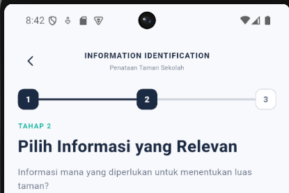

# AI DECLARATION

## 1. Daftar Alat AI
Alat AI yang digunakan dalam pengembangan aplikasi AlgoCase adalah ChatGPT.

## 2. Pembagian Peran AI dan Pengembang
*Bagian ini akan dilengkapi*

## 3. Studi Kasus Prompting

### 3.1 Pembuatan Halaman Information Identification

**Permasalahan**
Saya membutuhkan halaman Information Identification dengan progress indicator di bagian atas dan tampilan yang sesuai dengan rancangan aplikasi AlgoCase.

**Prompt kepada AI**
Prompt berikut merupakan rekonstruksi instruksi yang digunakan, bukan kutipan persis dari riwayat percakapan.

> Buatkan aku tampilan halaman information identification, nanti diatasnya ada progress nya dan sesuai dengan rancangan ide yang saya buat.

**Hasil Awal AI**
AI memberikan contoh kode Flutter untuk halaman Information Identification. Namun, progress indicator yang dihasilkan hanya menampilkan tiga tahap, sedangkan rancangan pembelajaran AlgoCase membutuhkan lima tahap.

**Penyesuaian Manual**
Saya menyesuaikan kode secara manual dengan menambahkan dua indikator sehingga jumlah tahap menjadi lima, sesuai dengan rancangan pembelajaran aplikasi.

**Dokumentasi Screenshot**
*Gambar 1. Kode awal progress indicator dari AI*

### 3.2 Perbaikan Navigasi dan Bottom Navigation
**Permasalahan**
Ketika kembali dari halaman pembelajaran ke halaman Case, bottom navigation tidak muncul seperti pada halaman utama.

**Prompt kepada AI**
> Aku mau perbaiki navigasi, wkt aku tekan tombol untuk kembali ke Case dari halaman pembelajaran, memang sudah kembali ke halaman Case, tapi bottom navigation di bagian bawah malah tidak muncul seperti di halaman utama. tlng perbaiki, pengennya wkt pengguna kembali ke halaman Case, tampilannya tetap ada bottom navigation seperti sebelumnya. Coba cek kode navigasi yang sekarang dan sesuaikan dengan struktur aplikasi yang sudah ada. Jangan mengubah tampilan halaman lain yang sudah benar.

**Hasil Awal AI**
AI menyarankan navigasi langsung menuju `CasesScreen`. Namun, solusi tersebut belum menyelesaikan masalah karena halaman tersebut hanya menampilkan konten daftar Case dan tidak mencakup bottom navigation.

**Penyesuaian Manual**
Saya memeriksa kembali struktur navigasi aplikasi dan menemukan bahwa halaman utama menggunakan `AppShell` sebagai wadah halaman yang mencakup bottom navigation. Saya kemudian menyesuaikan navigasi agar kembali melalui `AppShell` pada tab Case.

**Hasil dan Evaluasi**
Setelah navigasi disesuaikan, bottom navigation dapat ditampilkan kembali. Dari kasus ini, saya belajar bahwa hasil AI perlu diperiksa dan diuji berdasarkan struktur kode aplikasi sebelum diterapkan.
