# AlgoCase

**Aplikasi Pembelajaran Logika Algoritma melalui Studi Kasus**

## Tentang Aplikasi

AlgoCase merupakan aplikasi pembelajaran berbasis mobile yang dirancang untuk membantu pemula memahami logika algoritma melalui pendekatan studi kasus. Pengguna diajak menganalisis masalah, mengidentifikasi informasi yang relevan, menentukan input dan output, serta menyusun logika penyelesaian sebelum mulai membuat program.

## Fitur Aplikasi

- Splash screen dan pengenalan aplikasi.
- Input nama pengguna.
- Tutorial penggunaan aplikasi.
- Halaman Home dan daftar kasus.
- Halaman briefing kasus.
- Tahapan analisis dan penyelesaian kasus.
- Logic Builder.
- Halaman Profile.

## Teknologi yang Digunakan

- Flutter
- Dart
- SQLite

## Tampilan Aplikasi

### Splash Screen
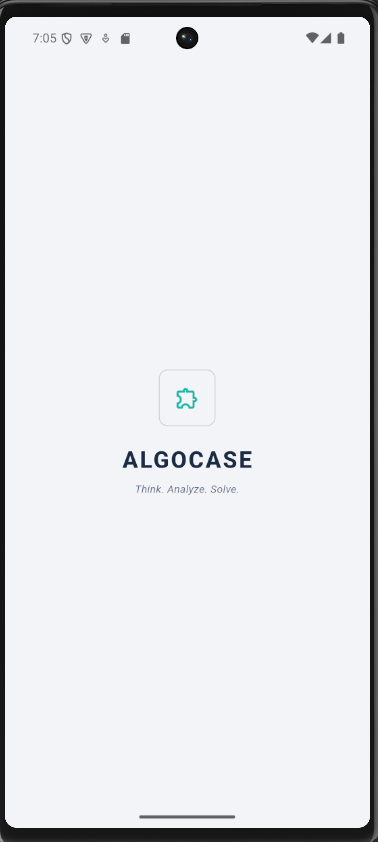

### Input Nama
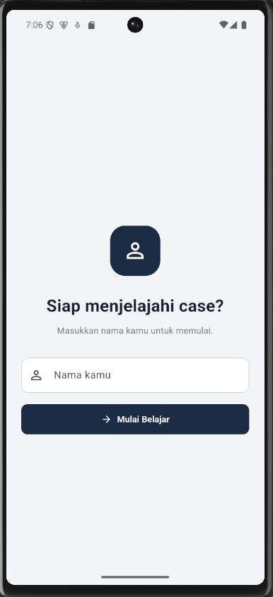

### Tutorial
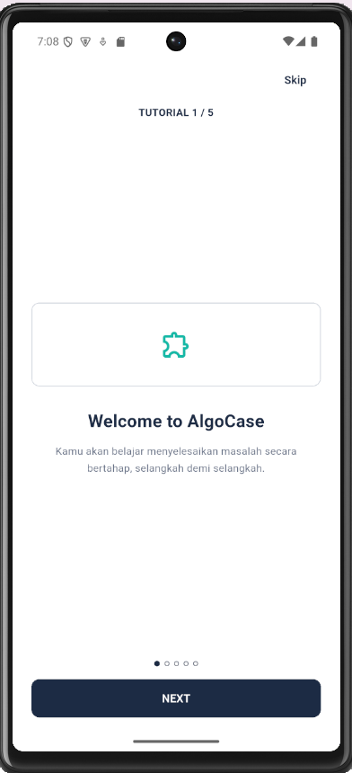

### Home
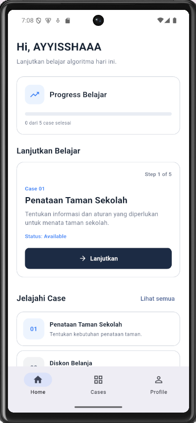

### Cases
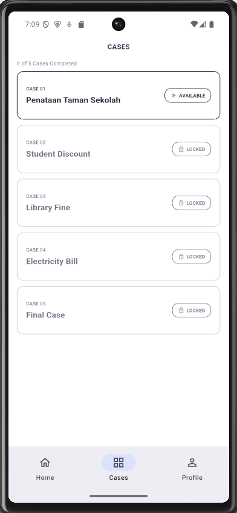

### Case Briefing
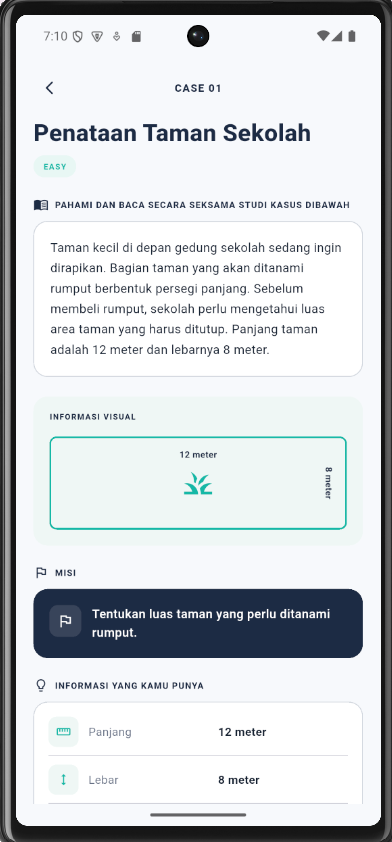

### Step 1 — Problem Analysis
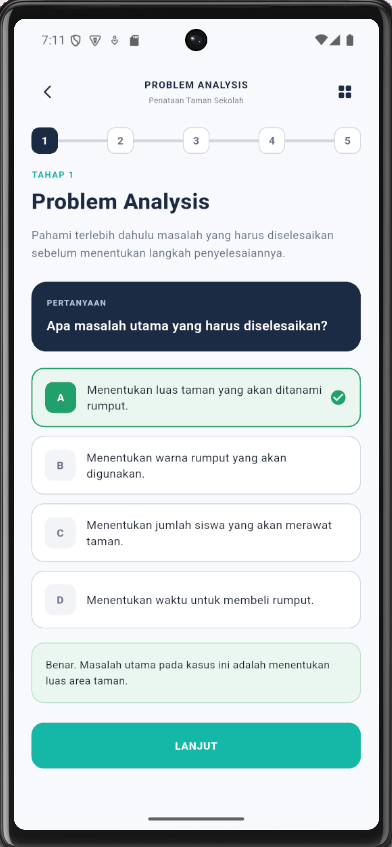

### Step 2 — Information Identification
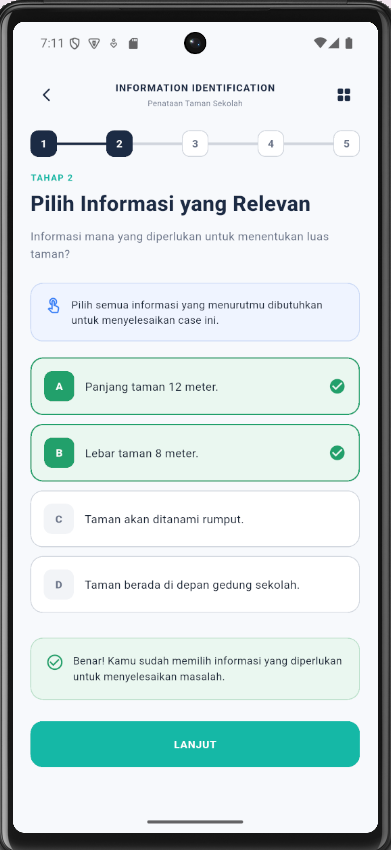

### Step 3 — Input, Output, and Rules
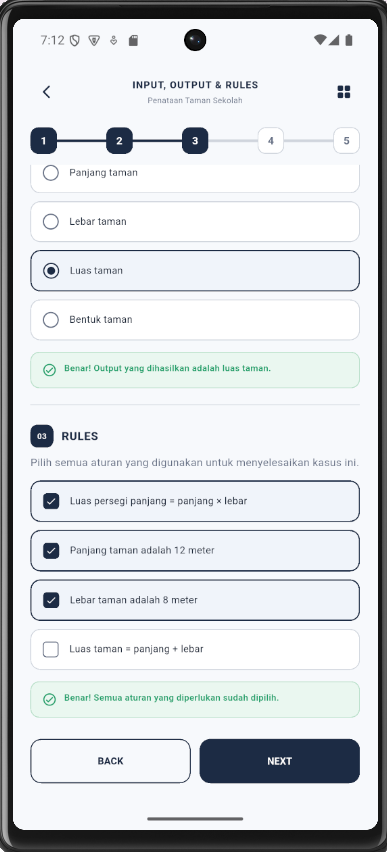

### Logic Builder
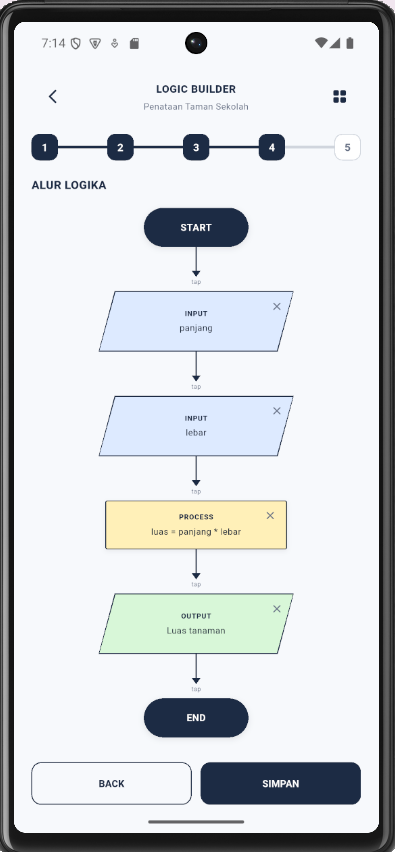

### Profile
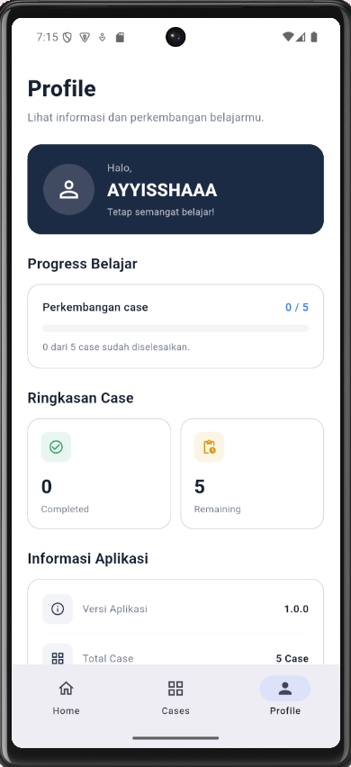

## Cara Menjalankan Aplikasi

1. Pastikan Flutter sudah terpasang.
2. Clone repositori ini atau unduh source code.
3. Buka folder proyek di terminal.
4. Jalankan perintah berikut:

   ```bash
   flutter pub get
   flutter run
   ```

## Pengembangan

AlgoCase dikembangkan sebagai proyek pembelajaran untuk membantu pengguna memahami dasar-dasar logika algoritma melalui studi kasus.
